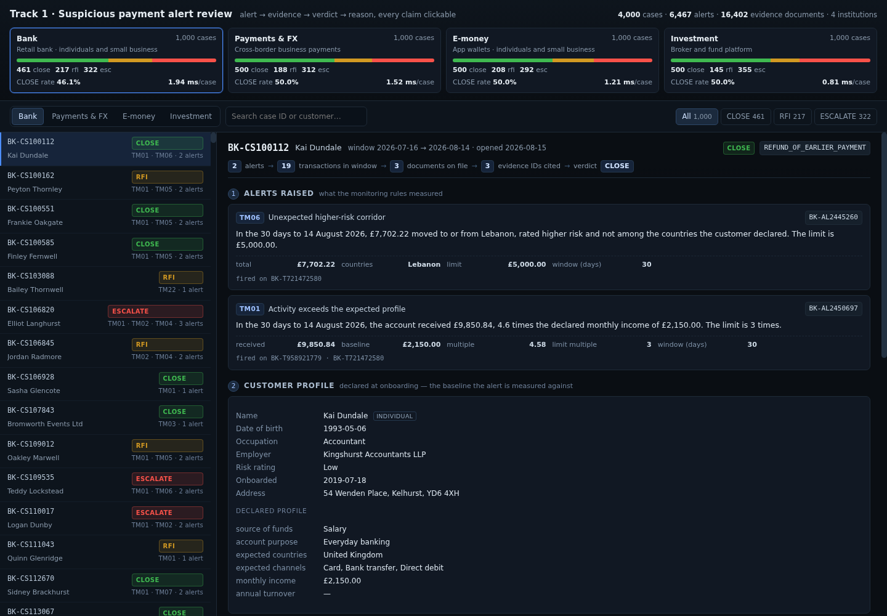

# Casefile — read the alert, read the evidence, write the verdict

A deterministic alert-closing system for financial-crime transaction monitoring. It reads one case
(monitoring alerts + the customer's file), locates the documents that would explain — or fail to
explain — the money, and returns **CLOSE / RFI / ESCALATE** with a reason code, a 2–4 sentence
reason that cites the actual amounts, dates and document IDs, and the evidence IDs it relied on.

Built for **Grok Bot London Financial Crime Hackathon — Track 1, "Stop suspicious payments"**.
Four institutions, 1,000 development cases each, no answers given.

```json
{"case_id": "BK-CS100112", "alert_ids": ["BK-AL2445260", "BK-AL2450697"], "verdict": "CLOSE", "reason_code": "REFUND_OF_EARLIER_PAYMENT", "reason": "The £7,702.22 is not new money: the venue email (EML-8464) confirms a full refund of the deposit for the cancelled booking, and the amount returned matches the amount paid out earlier. …", "evidence": ["BK-T721472580", "BK-T958921779", "EML-8464"]}
```



*The console (`ui/server.py`): verdict mix per institution on top, the case queue on the left, and on
the right the chain — alerts raised, customer profile, transactions in the window, documents on
file, verdict and reason. `EML-8464` is highlighted because the decision cites it.*

---

## The problem

A transaction-monitoring alert is cheap to raise and expensive to clear. The analyst gets a rule
firing ("£7,702.22 moved to or from Lebanon, limit £5,000"), a customer file, and a pile of
documents — invoices, solicitors' letters, cash reconciliations, venue emails, contact notes. The
work is not deciding whether the *rule* fired; it already did. The work is finding the one document
that explains the money, deciding whether it explains **all** of it, and writing down why, in a form
an auditor and the MLRO can follow a year later.

At this dataset's scale — 4,000 cases, 6,467 alerts, 16,402 documents, 209,212 transactions —
reading everything is the bottleneck. Clearing a case that needed an RFI or an escalation is the
expensive mistake (cost 10 in the scoring model); sending a case that could be closed to an RFI or
an escalation is cheaper (cost 3) but still wrong, and "escalate everything" scores zero on
verdicts by construction. The system therefore has to be **precise about what the evidence says**,
not cautious in the abstract.

## What it does

1. **Reads the alert literally.** Every rule the institution runs is mapped to the facts it
   measured (amount, counterparty, corridor, count, window) so the decision can quote them back.
2. **Locates evidence by number, not by vibe.** The case's transactions are matched against the
   documents on file by amount, counterparty, date and document template (an invoice for £3,450.00
   on 8 August, a solicitor's letter naming the estate and the exact entitlement, a cash
   reconciliation listing the four deposits).
3. **Decides under the institution's policy**, not a global one: the four SOPs differ in profile
   multiples, cash thresholds, beneficiary counts and which rules exist at all.
4. **Writes the reason and the citation list** — every claim in the reason is traceable to a
   document ID or a transaction ID present in the case files.

## Architecture

```
system/run <institution_dir> <output_file>        # sh wrapper, absolute paths, no cwd assumptions
   │
   └── system/main.py
         ├── load cases.jsonl + alerts.jsonl, sort by case_id        (deterministic order)
         ├── system/evidence.py  Index(dir)
         │     documents, template fingerprints, internal list, earlier reviews,
         │     find_by_amount() / find_by_text()
         ├── system/features.py  build_case(dir, case, index)
         │     alerts → transactions in window → documents on file
         ├── system/decide.py    decide(features, policy)
         │     red flags → list match → 11 CLOSE grounds → RFI → ESCALATE
         │     pure function: no disk, no clock, no randomness
         └── system/emit.py      one JSON line per case, fixed field order

output/<institution>.jsonl          1,000 lines per institution, one verdict per case
ui/server.py                        read-only console over data/ + output/ (stdlib http.server)
```

The decision is a **pure function of the case** — same inputs, same line, byte for byte. As a
check, three consecutive runs of each institution produced byte-identical files (MD5 compared).

## Run it

Python 3.8 or newer (developed and tested on 3.14.9), standard library only. No `pip install`, no
virtualenv, no network, no API keys — and no `data/` in the repository.

```sh
# one institution (this is exactly how the grader calls it: from inside system/, full paths)
cd system
./run /path/to/institutions/bank /path/to/output/bank.jsonl

# all four from the repo root
for i in bank payments_fx emoney investment; do ./system/run data/institutions/$i output/$i.jsonl; done
```

The console (also stdlib only, inline HTML/CSS/JS, no CDN — it works with the wifi off):

```sh
python3 ui/server.py                             # from the repo root → http://127.0.0.1:8000
python3 ui/server.py --port 8080 --host 0.0.0.0  # optional
```

It reads `data/institutions/*` and `output/*.jsonl` live. Pick an institution, filter by verdict,
search a case ID, and read the chain **alert → transactions → documents → verdict → reason**; every
evidence ID in the reason is clickable and highlights the document or transaction it names.

`ui/benchmark.json` holds the measured throughput below; delete it and the console shows `—` rather
than inventing a number.

## The four institutions, and why one policy is not enough

| | Bank | Payments & FX | E-money | Investment |
|---|---|---|---|---|
| Customers | 851 individuals + 149 small businesses | 1,000 businesses | 1,000 individuals | 1,000 individual investors |
| Unit of review | one customer, every alert in the window | one **held outgoing payment**, or one client window | one customer, window | one customer, window |
| TM01 profile limit | 3× monthly income / 2× turnover | 2× the monthly share of declared annual volume | 3× income / 2× turnover | 3× income / 2× turnover |
| Cash rules | TM03 3+ deposits of £9,000–9,999.99 in 10 days; TM05 £10k individual / £25k business | TM03 3+ payments to the same beneficiary at £9,000–9,999.99 | TM03 4+ top-ups of £800–999.99; TM05 £1k individual / £5k business | none — no cash |
| Counterparty rules | TM04 > 6 counterparties in 30 days | TM04 > 25 beneficiaries in 30 days; payments ≥ £10,000 need an invoice on file | TM04 > 6 | TM08 third-party funding ≥ £1,000; TM10 units sold within 90 days |
| Alerts in the dev set | 1,687 | 1,266 | 1,503 | 2,011 |

Consequences the system encodes: £13,000 in cash trips `TM05` at the bank; at the payments firm the
same money is a £13,000 payment to a supplier that needs an invoice on file before it is released,
and cash rules do not exist at all. "Sold the fund units 40 days after buying" is only a rule at
the investment firm. A payments case can be a single held payment with a beneficiary abroad. The
same alert name means a different threshold in each folder, so every threshold is read from
`system/policy/<institution>.json`, never from a global constant.

## How we answer the scoring

- **Verdicts (60% hidden / 20% dev).** Cost matrix drives the design, not caution: CLOSE is only
  returned when a document carries the money the alerts measured *and* covers every rule that
  fired. The contract's bar is "CLOSE only at confidence ≥ 0.72"; we implement that as evidence
  sufficiency — the amount must reconcile and the ground must cover every alert in the case, or the
  case does not close. Unproven activity escalates (`ESC_UNEXPLAINED_FUNDS`) instead of being
  guessed closed.
- **Reason quality (40% of each set).** The reason must name the amount, the counterparty, the date
  and the document ID, and for an RFI must say exactly what to ask for. Templates are filled from
  the case, never from a lookup of development cases.
- **Reproducibility (20%).** `sorted()` iteration everywhere, no `random`, no `time.time()`, no
  parallel processing, no dict-order dependence. Verified byte-identical across repeated runs.
- **Generalisation.** No case ID, customer name, amount or document ID from `data/` is written into
  `system/`. The system learns document *templates* and *thresholds*, not answers.

Snapshot of what the current build returns on the 4,000 development cases (13:35 GMT, 21 Nov 2026 —
the console recomputes this live from `output/*.jsonl`, so it is never stale in the demo):

| Institution | CLOSE | RFI | ESCALATE | CLOSE rate |
|---|---|---|---|---|
| Bank | 461 | 217 | 322 | 46.1% |
| Payments & FX | 500 | 188 | 312 | 50.0% |
| E-money | 500 | 208 | 292 | 50.0% |
| Investment | 500 | 145 | 355 | 50.0% |
| **All four** | **1,961** | **758** | **1,281** | **49.0%** |

## Three real cases

All three are development cases, quoted from the files in `data/institutions/bank/` and from
`output/bank.jsonl` as produced by `system/run`. Nothing below is paraphrased from a hypothetical.

### CLOSE — `BK-CS100112` · £7,702.22 from a Lebanese hotel is a refund, not a payment

- **Alerts.** `TM06` £7,702.22 moved to or from Lebanon, higher-risk and not among the countries the
  customer declared, limit £5,000.00. `TM01` £9,850.84 received in 30 days, 4.6× the declared
  monthly income of £2,150.00, limit 3×. On its face: an undeclared high-risk corridor plus an
  income spike — the shape of a case that gets escalated.
- **Evidence.** `EML-8464` — email from Kelstead Hotel and Gardens, 11 August 2026: the customer
  cancelled a wedding booking and the hotel refunded the deposit in full, £7,702.22. The credit
  `BK-T721472580` carries the reference `REFUND BOOKING 59396`; the original debit
  `BK-T675712778` on 15 June 2026 is for the same £7,702.22 with reference `BOOKING 59396`, and
  earlier review `BK-R975884` (17 June 2026) closed it as a documented wedding deposit.
- **Verdict.** `CLOSE` / `REFUND_OF_EARLIER_PAYMENT`, evidence
  `["BK-T721472580","BK-T958921779","EML-8464"]`. The amount matches to the penny, the booking
  reference matches, the counterparty matches — this is a reversal, not new money.

### RFI — `BK-CS103088` · a name-only list match that nothing on file settles

- **Alert.** `TM22` — payment of £1,315.00 to Noel Rayton on 8 August 2026 matched internal list
  entry `BK-L21007` **on name only**. A match on one detail does not prove it is the same party;
  equally, nothing on file proves it is not.
- **Evidence on file.** `KYC-2215`, `POA-4494`, `NTE-5771` (a contact note about a request for
  paper statements). No invoice, no agreement, no counterparty identification. Nothing else in the
  case is concerning: the rest of the window is salary, rent and card spending.
- **Verdict.** `RFI` / `RFI_COUNTERPARTY_DETAILS`. The reason asks for the counterparty's full
  name, date of birth and address, plus the invoice or agreement behind the £1,315.00 — one answer
  settles the case, so it is a question, not an escalation.

### ESCALATE — `BK-CS109535` · three strangers pay in, four equal slices go out to Lebanon

- **Alerts.** `TM06` £19,212.04 to or from Lebanon, undeclared corridor, limit £5,000.00. `TM01`
  £25,587.41 received, 8.4× the declared monthly income of £3,050.00.
- **What the money does.** Between 10 and 12 August three unrelated individuals pay in £8,271.55,
  £6,804.71 and £7,526.13. On 13–15 August four payments of **£4,803.01 each** go out by SWIFT to
  four different names in Lebanon, all with the reference `family support`. In and out are different
  parties in both directions, and the outbound legs are sliced into identical amounts.
- **Evidence on file.** `KYC-5138`, `POA-1166` and `CHT-4494`, a support chat where the only
  explanation is the customer's own statement: *"I am sending money to help my family there."* No
  invoice, no transfer record, no recipient details, no relationship to the three payers.
- **Verdict.** `ESCALATE` / `ESC_HIGH_RISK_CORRIDOR`, citing the six transactions. Unexplained
  third-party funding plus a high-risk corridor is suspicion, and once there is suspicion the
  customer is not asked — a tipping-off risk.

## Performance (measured, not estimated)

Wall clock of `system/run`, best of three runs, interpreter start included, on the container this
was built in (Linux, Python 3.14.9):

| Institution | 1,000 cases | per case |
|---|---|---|
| Bank | 1.94 s | 1.94 ms |
| Payments & FX | 1.52 s | 1.52 ms |
| E-money | 1.21 s | 1.21 ms |
| Investment | 0.81 s | 0.81 ms |
| **4,000 cases** | **5.48 s** | **1.37 ms** |

The slowest of the three rounds totalled 8.4 s for all four institutions. The contract's limit is
200 cases in 30 minutes; this runs 200 cases in well under a second. Cost is dominated by JSON
parsing, not by the decision: 209,212 transactions are read once per institution folder.

## Data model: why there is no database in the pipeline

The graded artifact is a command, not a service. It is called as
`system/run <folder> <output.jsonl>`, five times, from inside `system/`, on a machine we
do not control. Anything with state — a database, a cache, a WAL file — is a dependency
the grader may not have and a source of run-to-run drift, and reproducibility is a scored
component. So the store is the folder itself: immutable JSONL records plus Markdown
documents, read once, decided in memory, written out as an append-only decision log.
A full run of 1,000 cases takes 1.9 s and touches nothing outside its output file.

What a database is genuinely good for here is the other half of the job: a durable,
queryable record of *what was decided and why*, the thing an audited process needs and a
folder of JSONL cannot answer on its own. `tools/audit.py` builds that index with SQLite
in 1.4 s, entirely outside the scored path:

```bash
python3 tools/audit.py build
python3 tools/audit.py why BK-CS109535     # verdict, the alerts, every cited record
python3 tools/audit.py docs                # which document types actually close cases
python3 tools/audit.py rules               # verdict distribution per monitoring rule
python3 tools/audit.py sql "select verdict, count(*) from cases group by 1"
```

It is the difference between "the system says CLOSE" and "the system says CLOSE, and here
is the query that shows which 801 bank statements carried the most closes."

## Where the model is used, and where it is not

The verdict is produced by a deterministic function. The brief allows a model ("rules, language
models or both"), and a model is used in exactly two places, both of them unable to invent a fact:

1. **Reading prose the local parsers miss.** 46 of the 140 gift letters state the giver's date of
   birth in a sentence rather than a field. The local parser returns nothing for those, so the model
   is asked for the shortest verbatim span that answers the question, the span is checked character
   for character against the document, it must contain a birth cue ("born", "date of birth", "d.o.b")
   and it is then parsed by the same local parser. With no key this simply does not happen and the
   output is byte-identical.
2. **A second read of the file on escalations** (`system/second_opinion.py`). When the rules reach
   "unexplained", the model is asked whether one of the documents on file explains the activity. It
   may only name a document already in the case and quote it; the quote must carry an amount that
   reconciles with the alert, and the document's own type must be one that can close that rule, or
   the escalation stands.

Measured on the 4,000 development cases: the second read promoted **0 of 236** fallback cases, so it
is **off by default** and enabled per run with `HACKATHON_LLM_PROMOTE=1`. A model-dependent verdict is
also availability-dependent, and reproducibility is scored across five runs: a path that can only
change a verdict when a third-party API happens to respond is not worth two points of variance for
zero measured gain. The parsing path stays on because it is bounded (one call on the development set)
and cannot change a verdict unless the quote verifies.

Hard limits: OpenRouter only (`OPENROUTER_API_KEY`), temperature 0, 20 s per call, 400 calls and 120 s
of model time per run, and the first transport error disables the model for the rest of that run.
`HACKATHON_DISABLE_LLM=1` turns all of it off.

## Known gaps

- The decision table is tuned against the development set and its policy text; the hidden set may
  contain document templates we have not seen, which fall back to ESCALATE by design.
- `RFI` vs `ESCALATE` on thin evidence is the hardest boundary; the current split is conservative on
  suspicion and costs verdict points where an RFI would have been enough.
- At 12:24 GMT, 36 of the 4,000 reason strings repeat their own appositive in the corridor
  sentence ("moved to or from a higher-risk country, a higher-risk country the customer did not
  declare"). Cosmetic, but the reason is 40% of each score, so it is on the list to fix.

## Repository layout

```
system/          run, main.py, features.py, evidence.py, decide.py, emit.py, policy/*.json
output/          bank.jsonl, payments_fx.jsonl, emoney.jsonl, investment.jsonl  (1,000 lines each)
ui/              server.py (stdlib console), screenshot.png, benchmark.json (measured timings)
submission/      form.md, video-script.md, demo-3min.md
CONTRACT.md      the frozen output contract and file ownership
AGENTS.md        coding rules: stdlib only, determinism, no dev data in code
```

`data/` is excluded from the repository under the event terms; `output/` is included so the
verdicts can be read without running anything.

---

## What was verified, and how

- `python3 tools/validate.py output/<inst>.jsonl --data data/institutions/<inst>` — 4,000/4,000 cases,
  0 errors, 0 warnings: every cited ID exists in the case, every reason code belongs to its verdict,
  every figure in a reason appears in the alerts, transactions or document text it cites.
- `bash tools/repro.sh` — 5 runs x 4 institutions, byte-identical, 25 s.
- `python3 tools/selftest.py` — 43/43 checks, including 11 classes of deliberately broken output.
- `python3 tools/report.py` — verdict and reason-code distribution per institution and per rule.

The live console is at https://grok-spacexi.vercel.app (static export of the same `output/`, no server
required). `python3 ui/build_static.py` regenerates it.

*Known open item at the freeze: 469 cases where our pseudo-label expects RFI and the system escalates
(a conservative miss, cost 2 per case rather than 10; see `tools/LABELS.md`).*
